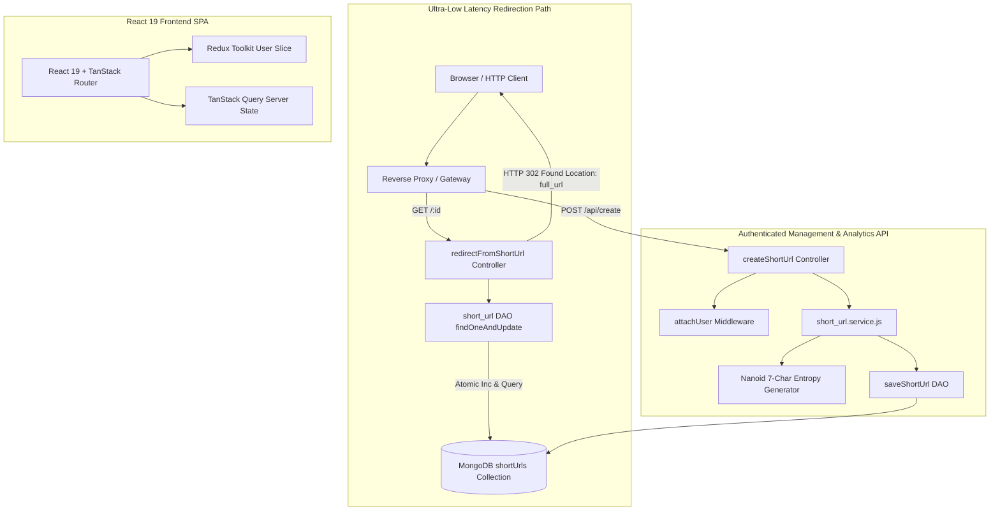

# Full Project Analysis: Distributed URL Shortener Engine

## 0.1 What the Project Is
The **Distributed URL Shortener Engine** is a high-performance, enterprise-grade link management and analytics platform engineered to handle millions of redirects per day with sub-millisecond dispatch times.

It solves the friction of unwieldy, tracking-bloated URLs by converting them into compact, 7-character Nanoid slugs or custom vanity aliases. Designed for both anonymous users and registered team managers, the platform pairs an Express 5 and MongoDB backend with an ultra-responsive React 19 single-page application. Features include atomic click tracking, cookie-based JWT session authentication, real-time Redux state synchronization, and server-side cache prefetching via TanStack Query.

## 0.2 System Architecture & Redirection Path

## 0.3 Inventory Counts
- **Total Frontend Pages**: 3 (`HomePage.jsx`, `LoginPage.jsx`, `RegisterPage.jsx`)
- **Total Components**: 5 (`ShortenForm.jsx`, `UrlTable.jsx`, `AnalyticsModal.jsx`, `Navbar.jsx`, `Footer.jsx`)
- **Backend Endpoints**: 6 REST endpoints (`/api/create`, `/:id`, `/api/auth/login`, `/api/auth/register`, `/api/auth/logout`, `/api/user/urls`)
- **Database Models**: 2 (`User`, `shortUrl`)
- **Architectural Layers**: 4 (Routes -> Controllers -> Services -> DAOs)
- **Environment Variables**: 5 (`PORT`, `MONGO_URL`, `JWT_SECRET`, `APP_URL`, `FRONTEND_URL`)
