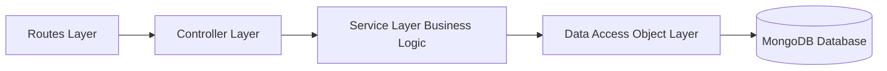

# System Architecture & Scaling to 100x

## Layered Architecture
The application adheres strictly to the classic Enterprise Layered Architecture:

## Scaling to 100x Load: The First Three Bottlenecks
1. **Database Read IOPS on Redirections**: Under 100,000 QPS, direct MongoDB queries will saturate connection pools. *Mitigation*: Introduce Redis caching (read-through) with LRU eviction for the hottest 20% of slugs.
2. **Write Lock Contention on Click Counters**: Frequent `$inc` operations on viral links cause document-level lock contention. *Mitigation*: Buffer click events in Redis or Apache Kafka and write back to MongoDB in batches every 5 seconds.
3. **Network Bandwidth on Gateway**: Serving millions of redirects can saturate gateway network cards. *Mitigation*: Deploy multi-region Cloudflare Workers / Fastly VCL at the edge to perform redirects directly from edge key-value stores.
