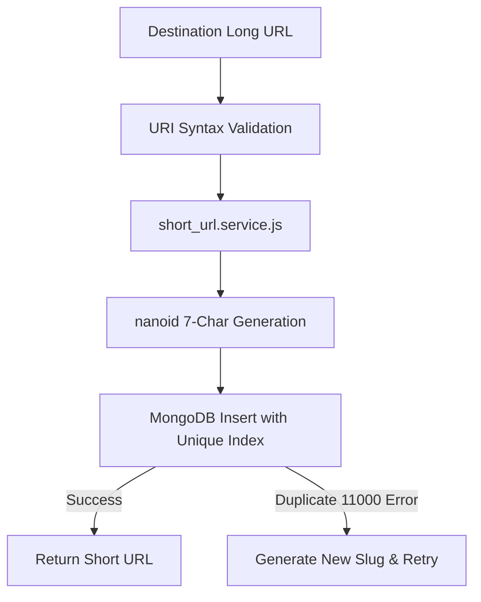

# F1: Collision-Resistant Nanoid Slug Generation

## 1. Description & User Experience
Users input a destination URL into the shortening interface (`frontend/src/components/ShortenForm.jsx`). The system validates the URI structure and issues a compact 7-character slug.

## 2. Technical Architecture & Permutation Mathematics
Using a 64-character URL-safe alphabet (`A-Za-z0-9_-`) across 7 characters yields:
$$64^7 = 4,398,046,511,104 \text{ unique IDs}$$
Even at an aggressive generation rate of 1,000 URLs per second, it would take decades before encountering a 1% probability of collision.

## 3. Say It Out Loud
"I implemented the core link shortening engine using Nanoid with a customized 7-character alphabet. With 64 possible characters per slot, this provides over 4.3 trillion unique combinations, making collision probability virtually zero for standard web scale. I chose Nanoid over MD5 or SHA-256 truncation because cryptographic hashes are prone to collision when truncated to 7 characters and contain non-URL-safe characters. If a collision ever occurs, the MongoDB unique index triggers a duplicate key error, which the service catches to automatically regenerate a fresh slug."
