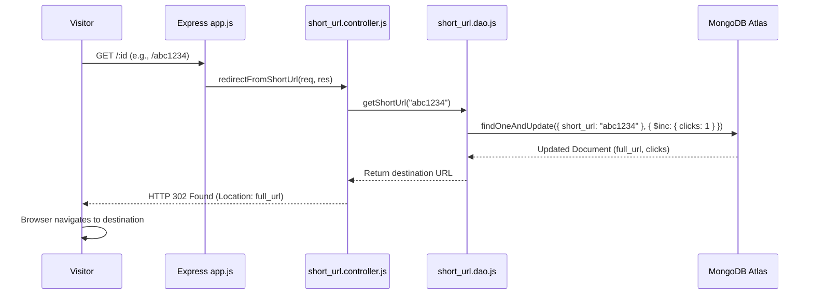

# F2: Atomic Redirection & Real-Time Click Telemetry

## 1. Description & Redirection Mechanics
When a visitor accesses `http://localhost:3000/:id`, the server resolves the 7-character slug, increments the total click counter in an atomic operation, and immediately issues an HTTP 302 Found redirect to the destination URL.

## 2. Sequence Diagram

## 3. HTTP 301 vs 302 Trade-Off
- **HTTP 301 (Moved Permanently)**: Browsers cache the destination indefinitely. While this reduces server load, subsequent visits bypass the server entirely, making accurate click analytics impossible.
- **HTTP 302 (Found / Temporary)**: Browsers request the redirection endpoint every time, guaranteeing 100% accurate click analytics.

## 4. Say It Out Loud
"For the redirection pipeline, I chose HTTP 302 temporary redirects over HTTP 301 permanent redirects. While 301 allows browser-level caching, it causes subsequent clicks to bypass our server, which destroys our ability to track analytics. In the database layer, I used MongoDB's atomic `findOneAndUpdate` with the `$inc` operator. This guarantees that even if thousands of users click the link simultaneously during a viral campaign, the click count remains mathematically exact without requiring pessimistic distributed locks."
