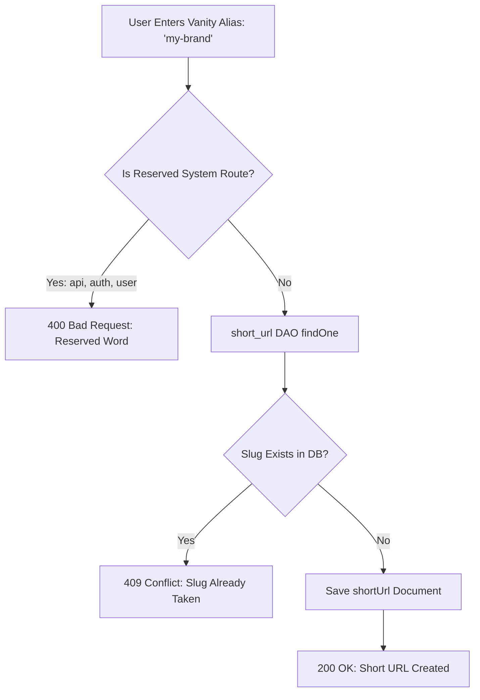

# F3: Custom Vanity Alias & Collision Detection

## 1. Description & Workflow
Authenticated users can create custom branded short links (e.g., `bit.ly/my-portfolio`). The backend verifies alias availability, rejects reserved routes, and enforces uniqueness across the entire database.

## 2. Conflict Handling Diagram

## 3. Say It Out Loud
"To give users personalized branding, I implemented custom vanity aliases. When an authenticated user submits a custom slug, the system first verifies that the string does not collide with reserved system paths like `/api` or `/auth`. Next, the service checks database uniqueness before persistence. If two users attempt to claim the exact same alias simultaneously, the database's unique B-tree index triggers a code 11000 duplicate key exception, which our custom ConflictError class translates into a clean HTTP 409 status code with a user-friendly message."
